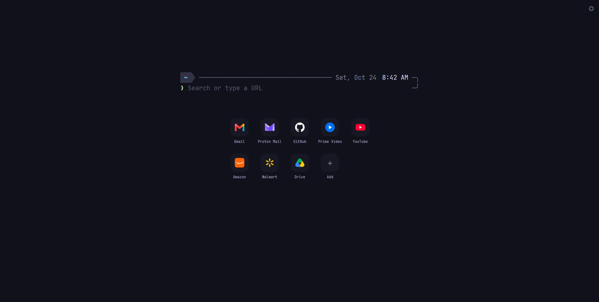

# tilde

A new tab page for Brave and other Chromium browsers that looks like a terminal prompt.
Every site you save is on one screen, and the prompt searches the web, opens addresses,
and runs a few handy commands. You never have to type a command, though: everything also
works with the mouse.



## Install

tilde isn't in the Chrome Web Store yet, so for now you load it yourself. It takes about
two minutes.

1. **Get the code.** On this repo's GitHub page, click **Code**, then **Download ZIP**,
   and unzip it somewhere you'll keep it (your browser loads tilde from that folder, so
   don't delete it afterwards). If you use git, `git clone
   https://github.com/tanmaysawaji/tilde.git` works too.
2. **Open your browser's extensions page:** `brave://extensions` in Brave,
   `chrome://extensions` in Chrome, or `edge://extensions` in Edge.
3. **Turn on Developer mode.** It's a switch at the top right (in Edge, on the left).
4. **Click Load unpacked** and choose the tilde folder: the one with `manifest.json` in
   it (from the ZIP, that's `tilde-main`).
5. **Open a new tab.** If the browser asks whether to keep the page an extension changed,
   choose to keep it.

Your new tab is now tilde. Click the **+** tile to add your first site.

## Update

Download the ZIP again and replace the old folder's contents with the new ones (or run
`git pull` in it), then click the reload button on tilde's card on the extensions page.
Your sites and settings stay where they are.

Before removing tilde, export a backup (see [Backups](docs/guide.md#backups)): removing
the extension also removes your saved sites.

## Using tilde

The [user guide](docs/guide.md) covers everything. In short:

- **Search or open a site:** type in the prompt and press Enter. Addresses like
  `github.com` open directly; anything else searches with your browser's search engine.
- **Add, edit, or remove sites:** the **+** tile adds one; hover a tile and click its
  pencil to rename it, change its address or icon, or delete it.
- **Rearrange:** drag a tile onto another. Hold it at the side of the grid to carry it to
  the next page.
- **Settings and backups:** the gear in the top right corner.
- **Commands:** type `/help` in the prompt to list them.

## Feedback

Trying it before it's published? Send me a message with anything that's broken,
confusing, or missing. Screenshots help.

## Credits

tilde's look comes from other people's generous work:

- [JetBrains Mono](https://github.com/JetBrains/JetBrainsMono), the typeface, bundled in
  `fonts/` under the SIL Open Font License 1.1 (see `fonts/OFL.txt`).
- [Catppuccin](https://github.com/catppuccin/catppuccin), the Mocha color palette (MIT).
- [Starship](https://starship.rs), whose prompt the search bar is modeled on.

## For developers

tilde is plain HTML, CSS, and JavaScript with no build step and no dependencies. The tests
use Node's built-in test runner (Node 20 or later):

```sh
node --test
```

**About `key` in `manifest.json`:** this is a public key, not a secret. Brave derives the
extension ID from it, so saved sites survive reloading the extension from a different
folder. The private half was never kept. Remove it (or replace it with the Web Store's
key) before publishing.
